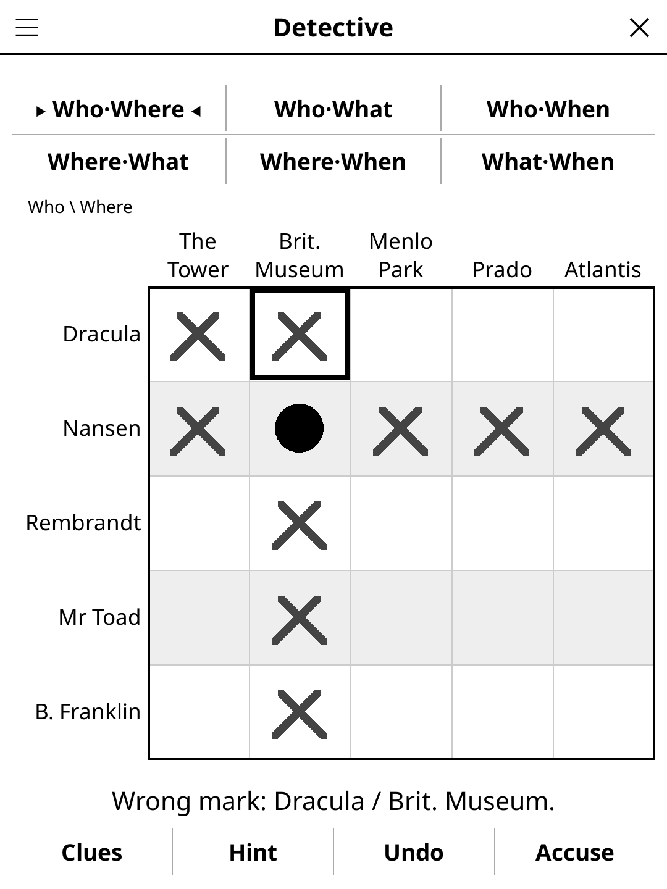

# detective.koplugin

**Detective** (*Enquêtes*) for [KOReader](https://github.com/koreader/koreader):
solo logic-deduction cases. Someone ate Napoleon's cheese — was it Mozart at
the Louvre with the umbrella, or Marie Curie on the Great Wall with the
teapot? Read the clues, fill the logic grid, accuse.

## Screenshot

## Rules

- Each suspect was in exactly one place, had exactly one object and (Medium
  and Hard) was there at exactly one time. No two suspects share any of them.
- The case gives one fact about the culprit (when — or, in Easy, where — it
  happened); the clues give the rest. Only one answer fits all the clues.
- **The grid**: one tab per pair of categories (Who·Where, Who·What,
  Where·What…). Tap a cell once for a cross (no), twice for a dot (yes), a
  third time to clear it. A dot crosses out the rest of its row and column.
- In portrait the screen shows either the clues or the grid: *Grid* and
  *Clues* in the action bar swap them (both at once would need a font too
  small for a 6" screen). Landscape shows both side by side.
- Tap a clue to grey it out. ◀ ▶ turn the clue pages when they don't fit.
- **Accuse**: pick the culprit, the place and the object. One accusation per
  case.
- "One hour before" means the time slot just before; "earlier than" means any
  earlier slot.

## Multiplayer

*Detective · multiplayer* (Tools → Games → Party & quiz, or menu → *Mode*):
lay the reader in the middle of the table and investigate together.

- A match is 1, 3, 5 or 7 cases (*Rounds*); 2 to 8 players, names typed once
  and remembered.
- Each case opens with **one clue**; *Next clue* reveals another one.
- Anyone may **accuse once per case**: *Accuse* asks who is accusing, then the
  culprit, place and object. Wrong: that player can't accuse again in this
  case (they keep helping). Right: that player wins the case.
- **Points**: 1 + the number of clues still hidden. A 7-clue case solved with
  3 clues shown scores 5; with all 7 shown, 1. If everyone accuses wrongly,
  or the case is given up (*Show solution*), nobody scores.
- The clue page shows who may still accuse and the scores; the status line
  shows the case, the clues shown and the current prize. The final
  scoreboard names the winner (or a tie). No hints in multiplayer.

## Features

- **Generated cases**: Easy 3 suspects × 3 categories, Medium 4 × 4 (with
  times), Hard 5 suspects × 4 categories. Every case can be solved on the
  grid by pure deduction, never by trying an answer to see if it breaks:
  the generator adds true clues until a built-in logic-grid solver fills
  every grid, then drops every clue that solver can do without.
- **Levels** are graded by that solver: Easy needs only a few deductions
  across grids (a dot in one grid tells you something in another); Medium
  up to 25 of them plus some time-order reasoning ("earlier than", "one hour
  before"); Hard at least 28 cross-grid and 15 time-order deductions. Work is
  capped by attempt counts (not the clock), so a seed gives the same case on
  every device; a hard case takes about 35 ms at worst on a desktop (a
  progress bar shows if it takes a moment on the reader).
- Clue kinds: "is / is not", "either … or …", "one hour before", "earlier
  than", each with three or four phrasings ("A witness is certain: …",
  "… and … are two different people", "One hour after …, …").
- **Theme packs** (menu → *Case pack*): History & legends, Art & museums,
  Science, Pop culture & fiction, Around the world, or all of them.
- Column labels too long for their column are written upright, as in
  printed logic-grid books, so they keep a readable size.
- **Hints**: the first tap frames a cell (a wrong mark first, then a cell a
  clue settles directly), the second marks it.
- **Daily Challenge**: today's case, the same for everyone.
- **Show solution** fills the grid and closes the case.
- Cases in French or English (*Language* setting, defaults to KOReader's
  language): in French about 330 crimes, 310 suspects, 200 places and 190
  objects; in English about 90 crimes, 180 suspects, 116 places and 125
  objects; with a *Theme* setting (all, history, art, science, fiction,
  world) to pick which ones a case draws from.
  Interface in English, French, Spanish and German.
- The case in progress is saved when you close the game.

## Case for Two (two readers)

**Case for Two** (FR *Enquête à deux*) is a mode for two players with a
reader each, under **Tools → Games → Two readers**. One player starts a game
and reads its five-digit code aloud; the other joins with it. Both readers
deal the same case (the code carries the difficulty and the language), but
each shows only half of the clues — the odd ones or the even ones — and
neither half is enough on its own. Read your clues to each other, fill your
own logic grid, and accuse when you both know. No hints in this mode.

## Installation

Copy `detective.koplugin/` (with the `common/` folder from `game-common`)
into KOReader's `plugins/` folder. Start it from the Tools menu → *Detective*.

## License

GPL-3.0 — see [LICENSE](LICENSE).
